# Agent SecOps

**An AI-assisted SecOps agent that gates Terraform deployments against Azure CAF and WAF before they reach the cloud.**

Project ID 19727UG01 · BCSE497J Project-1 · VIT
Author: Gaurish Todi · Guide: Dr. SM Farooq

---

## The one-sentence version

A SecOps agent sits between `terraform plan` and `terraform apply` in a GitHub Actions pipeline, reads the plan JSON, judges every proposed resource against Cloud Adoption Framework governance and Well-Architected Framework pillars, and returns **pass / remediate / block** with a plain-language report — so a non-compliant resource is stopped before it exists, and before it costs anything.

```
Developer → GitHub Actions → terraform plan → plan.json
                                                  │
                                    ┌─────────────▼─────────────┐
                                    │   AGENT SECOPS GATE       │
                                    │  Layer 1: CAF/WAF rules   │
                                    │  Layer 2a: organisational │
                                    │   customized policies     │
                                    │  Layer 2b: graph risk     │
                                    │  Layer 3: thresholds &    │
                                    │           waivers         │
                                    └─────────────┬─────────────┘
                                     BLOCK ◄──────┴──────► PASS
                                       │                     │
                              report on the PR        terraform apply
                              nothing deployed      → Azure / AWS / GCP
```

## Why this is not just another Checkov

Static policy-as-code tools (Checkov, tfsec, OPA, Sentinel) only catch violations of rules **someone already wrote**. CAF and WAF are narrative documentation — thousands of words of architectural judgement that were never turned into rules. Agent SecOps adds a reasoning layer over that documentation.

Measured on the seeded test set (`docs/benchmark-results.md`). The numbers are
identical on the hand-written fixtures and on real `terraform show -json`
output from the seeded modules (`examples/plans/real/`), and a violation only
counts as detected when the specific rule or probe labelled for it fires:

| Metric | Value |
|---|---|
| Seeded violations across Azure, AWS, GCP | 42 |
| Detected by deterministic rules alone | 33 (78.6%) |
| Detected with the reasoning layer | 42 (100%) |
| **Recovered by reasoning alone** | **9** |
| Verdict-affecting false positives on the compliant module | **0** |
| Gate latency | < 15 ms |

The offline reasoning layer is a set of hand-written probes derived from the
framework knowledge base, and the seeded modules were written by the same author,
so treat recall as an upper bound rather than a field measurement.

## Quick start — 60 seconds, no cloud account needed

```bash
pip install -r requirements.txt

# The compliant module passes (exit 0)
python -m agent.cli evaluate --plan examples/plans/azure_compliant.plan.json

# The seeded misconfigurations are blocked (exit 2)
python -m agent.cli evaluate --plan examples/plans/azure_noncompliant.plan.json

# Everything at once
bash scripts/demo.sh
```

## The visual dashboard

```bash
python -m dashboard.server        # opens http://localhost:8000
```

A React frontend over a small Python backend, driving the same engine as the
CLI. Three tabs: **Gate** (verdict, pillar/severity charts, findings with
fixes), **Benchmark** (detection numbers, live), **Rules** (the catalogue).

No `npm install` and no build step — React comes from a CDN and JSX compiles in
the browser, so the whole thing is one command. The **Reasoning layer** toggle
is the demo worth rehearsing: switch it off and watch the findings that no
hand-written rule produces disappear.

> The dashboard is a presentation layer. In the pipeline the gate is a CLI
> whose exit code decides whether `terraform apply` runs.

Other commands:

```bash
python -m agent.cli rules                  # the 22-rule catalogue
python -m agent.cli explain WAF-SEC-004    # why a rule exists, in framework terms
python -m pytest tests/ -q                 # 151 tests
python scripts/benchmark.py                # detection + false-positive numbers
```

## Demonstration — step by step

All screenshots live in [`docs/screenshots/`](docs/screenshots/). The walkthrough
follows one real run: a Terraform plan goes in, a verdict and an exit code come out.

### Step 1 — Choose a plan and set the controls

Pick a bundled plan (or upload / paste your own `terraform show -json` output),
decide whether the reasoning layer is on, and optionally run the real
`terraform plan → gate` pipeline.

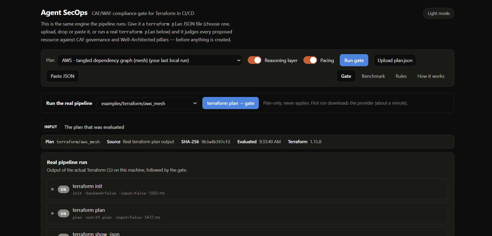

### Step 2 — Run the real pipeline

The dashboard drives the actual Terraform CLI (`init`, `plan`, `show -json`) and
then the gate. The timings are measured, not animated.

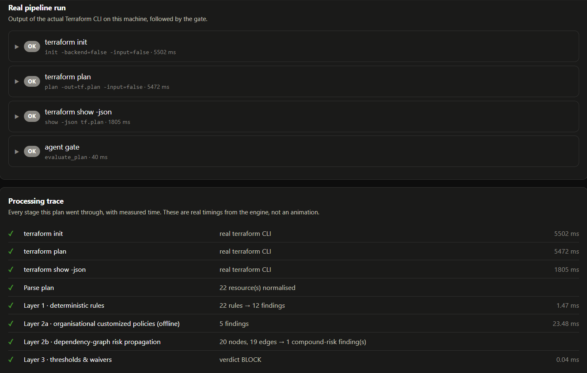

### Step 3 — The plan is normalised into resources

Every provider resource is mapped to a cloud-agnostic kind, so one rule covers
Azure, AWS and GCP.

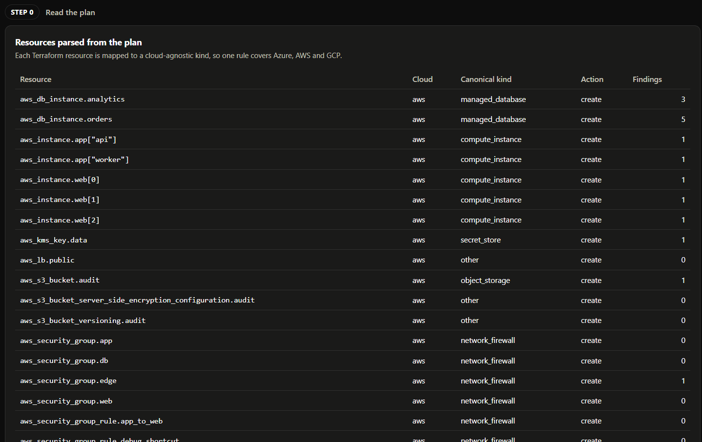

### Step 4 — Layers produce findings

Deterministic rules, organisational policy, reasoning probes and the dependency
graph each contribute findings. Every finding names the CAF/WAF pillar it
violates and carries a copy-pasteable fix.

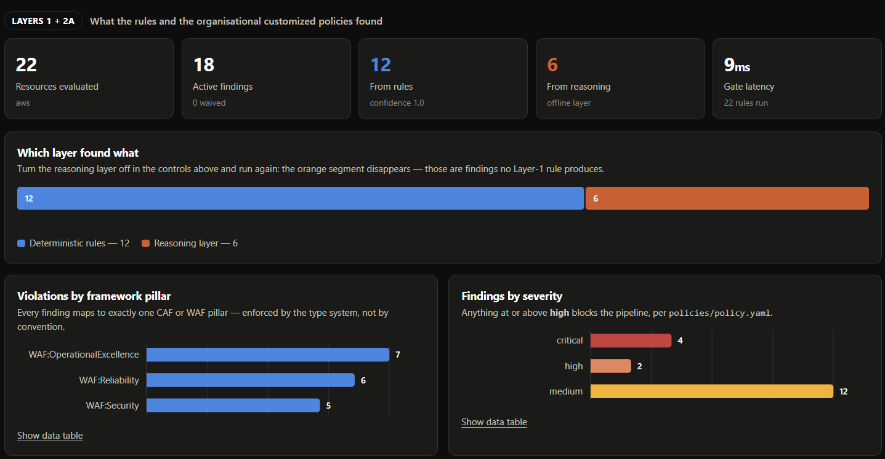

### Step 5 — Dependency-graph risk propagation

The graph reasoner connects resources to each other, so an exposed path that
reaches a weak resource becomes one compound-risk finding.

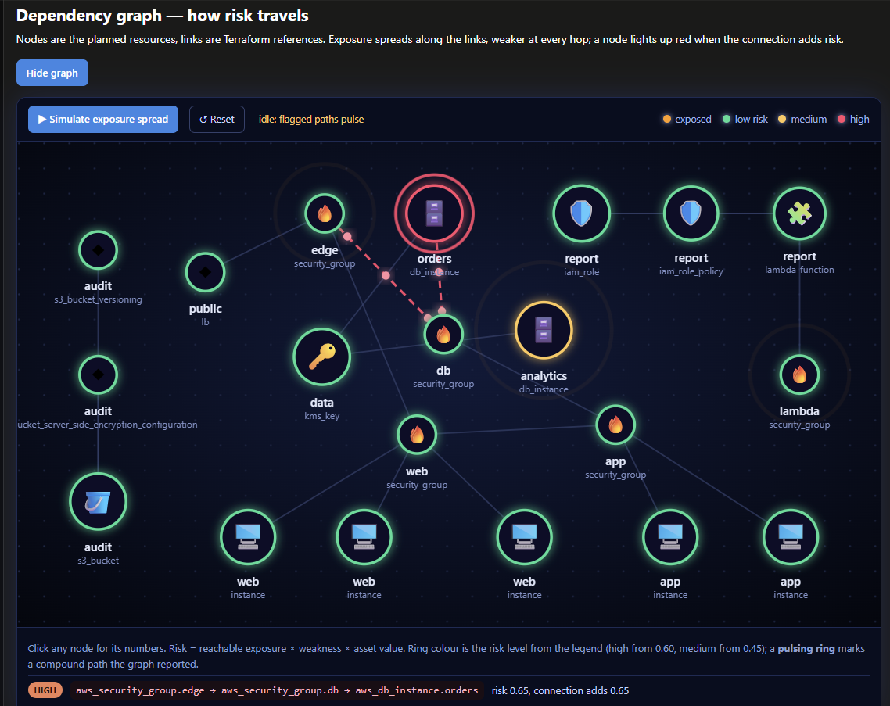

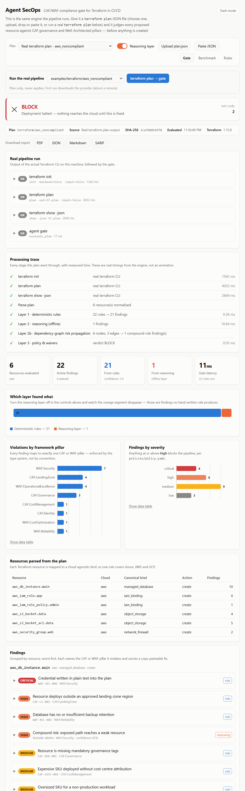

### Step 6 — The verdict and the exit code

Thresholds and waivers from `policies/policy.yaml` turn the findings into
`pass`, `remediate` or `block`, and the exit code is what stops
`terraform apply`.

| Compliant plan → `pass`, exit 0 | Non-compliant plan → `block`, exit 2 |
|---|---|
| 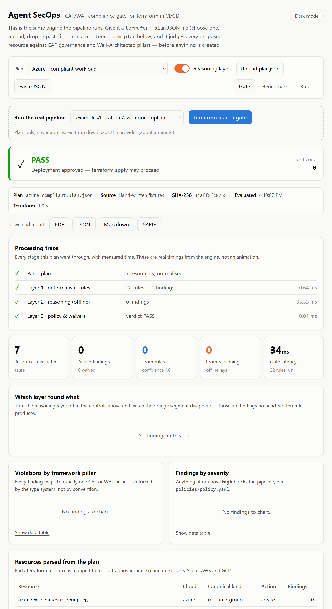 | 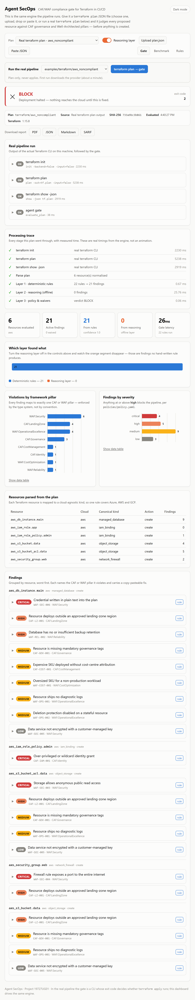 |

### Step 7 — Show what the reasoning layer adds

Switch the reasoning layer off and the findings that no hand-written rule
produces disappear.

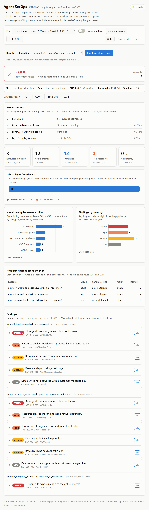

### Step 8 — Export the report

The same result downloads as PDF, JSON, Markdown or SARIF.

| PDF report | JSON report |
|---|---|
| 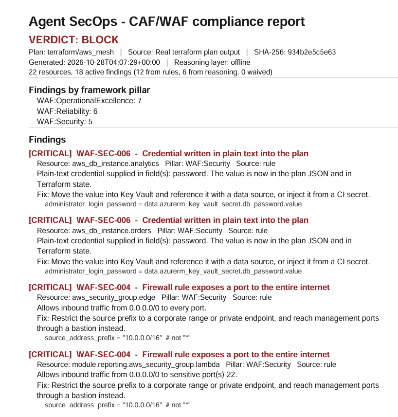 | 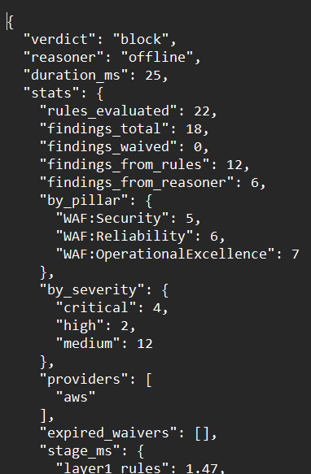 |

### Step 9 — Benchmark and rule catalogue

Detection and false-positive numbers are computed live, and the Rules tab lists
all 22 rules.

| Benchmark | Rules |
|---|---|
| 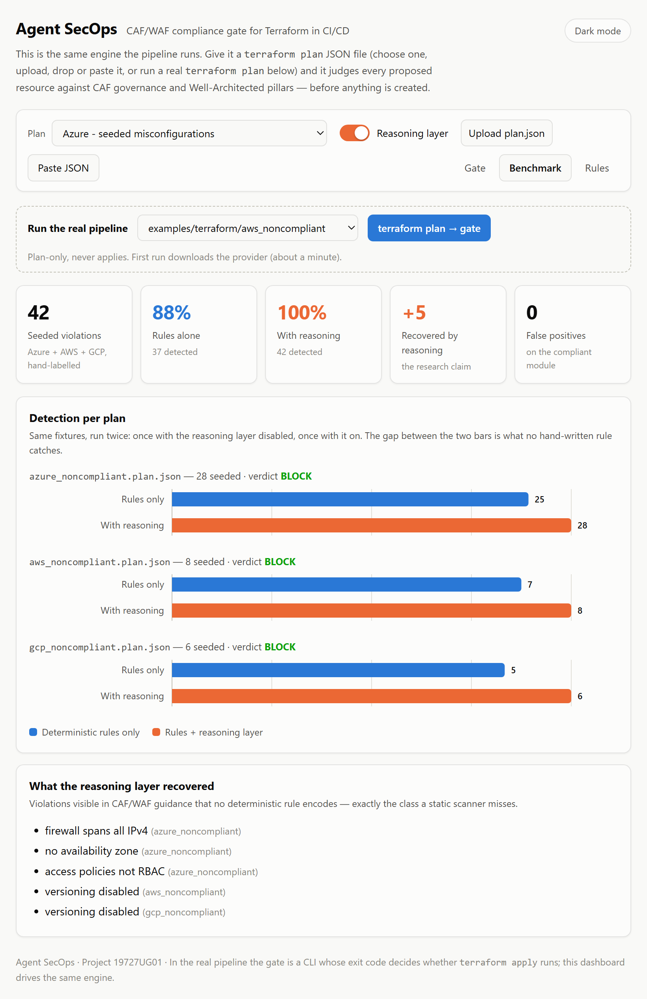 | 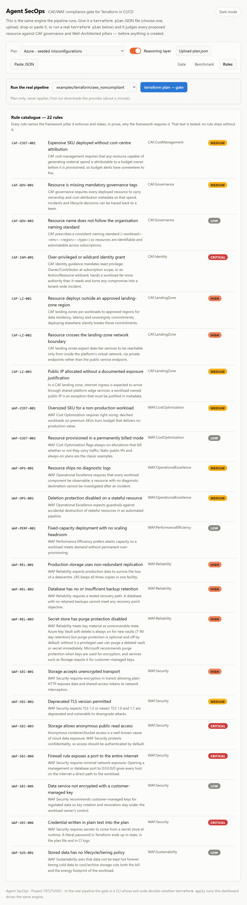 |

### Step 10 — Team scenario

A larger multi-resource plan showing how findings group by resource and severity.

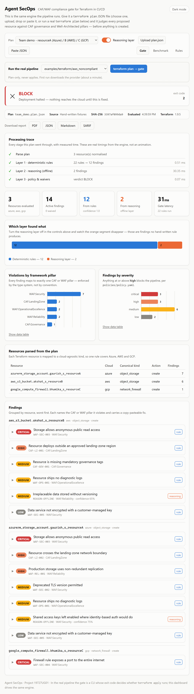

### Step 11 — In CI/CD on GitHub Actions

The gate runs as a pipeline step. A block stops the job, and a gated deployment
asks for approval before anything is applied.

| Workflow run | Approval gate |
|---|---|
| 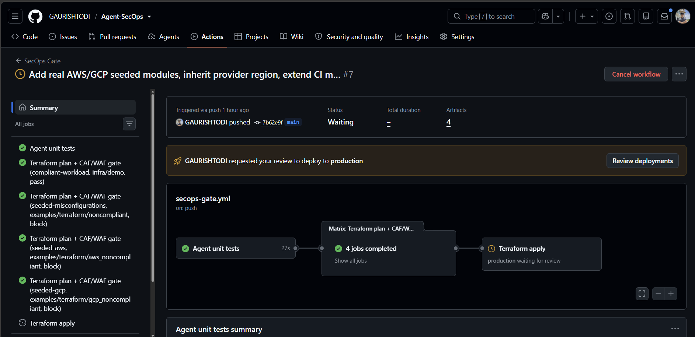 | 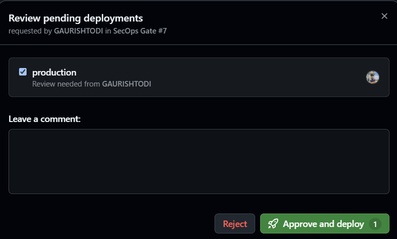 |

### Step 12 — Cloud proof and cost control

The Azure resource groups used for the real deployment test, kept to a minimum
to protect student credits (see [Cost discipline](#cost-discipline)).

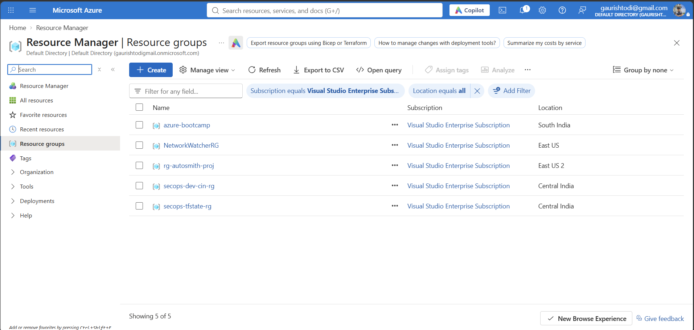

## Layer 4 — local LLM advisor (Ollama, optional)

```bash
ollama pull qwen2.5:3b
python -m agent.cli evaluate --plan examples/plans/azure_noncompliant.plan.json --advisor ollama
python scripts/eval_advisor.py          # tiny eval over the seeded plans
```

A local model explains each top finding in plain language and suggests a fix.
**It never decides.** The verdict and exit code come from Layers 1-3 and are fixed
before the model is called. Guardrails: redacted prompt, JSON-only output with
length limits, advice naming a resource that is not in the plan is dropped, and any
Ollama error or timeout leaves the result untouched. Covered by `tests/test_advisor.py`.

Measured with `qwen2.5:3b` on CPU: 15/15 advice items passed the guardrails across
the three seeded plans, about 5-8 s per finding. Guardrails check *form and grounding*,
not correctness, and a 3B model sometimes suggests a weak fix, which is why it is
advisory only.

## Exit codes — these *are* the gate

| Code | Verdict | Pipeline behaviour |
|---|---|---|
| 0 | `pass` | `terraform apply` proceeds |
| 1 | `remediate` | Warn; proceeds only with `--soft-fail` |
| 2 | `block` | Pipeline stops, nothing is deployed |
| 3 | error | Bad plan file or usage |

## What it checks

**CAF — portfolio governance.** Mandatory tags and ownership · naming standards · approved landing-zone regions · public network boundary · budget attribution · least-privilege identity.

**WAF — workload design.** Security (TLS, anonymous access, open ingress, hardcoded secrets, encryption) · Reliability (redundancy, backups, purge protection) · Cost Optimization (right-sizing, idle allocations) · Operational Excellence (diagnostics, deletion guards) · Performance Efficiency (autoscaling) · Sustainability (data tiering).

22 deterministic rules across 9 pillar areas, plus 12 reasoning probes. Full catalogue: `python -m agent.cli rules`.

## Repository layout

```
agent/                     the gate itself
  models.py                cloud-agnostic data model (Resource, Finding, Verdict)
  plan_parser.py           Terraform plan JSON → normalized resources
  rules/
    base.py                rule base class + registry
    caf.py                 CAF governance / landing zone / cost / identity
    waf.py                 WAF security / reliability / cost / ops / perf / sustainability
  reasoner/
    base.py                retrieval + prompt construction, shared by both reasoners
    offline.py             free deterministic heuristics (CI default)
    llm.py                 Azure OpenAI / Anthropic, with caching + cost caps
  knowledge/
    caf_waf_kb.yaml        the framework guidance the reasoner reads
  engine.py                orchestration: rules → reasoning → policy → verdict
  report.py                Markdown (PR) / JSON / SARIF renderers
  cli.py                   the command the pipeline runs
  config.py                thresholds, rule overrides, time-boxed waivers

dashboard/                 local demo UI (not part of the gate)
  server.py                stdlib HTTP backend around the engine
  static/                  React frontend: charts, findings, benchmark

policies/policy.yaml       the only file a platform team needs to edit
infra/demo/                minimal compliant Azure module (< ₹50/month)
examples/terraform/        seeded modules (plan-only, ₹0): Azure, AWS, GCP, plus four
                           dependency-graph showcases: aws_mesh, aws_thousand_cuts,
                           aws_shared_trust (harmless alone, high risk together) and
                           aws_risk_spectrum (every risk level in one graph)
examples/plans/            hand-written plan fixtures: Azure ×2, AWS, GCP
  real/                    real `terraform show -json` output of the same modules
.github/workflows/         the pipeline the gate lives in
scripts/                   Azure bootstrap, cost watchdog, teardown, benchmark
docs/                      architecture, Azure setup, cost control
tests/                     146 tests
```

## Connecting Azure

Full walkthrough: **[docs/azure-setup.md](docs/azure-setup.md)**. Short version:

```bash
az login
bash scripts/azure-bootstrap.sh <your-github-org>/<your-repo>
```

This creates only free or near-free things: a resource group, a state storage account (~₹2/month), an Entra ID app with **GitHub OIDC federation so no secret is ever stored**, a resource-group-scoped role assignment, and a budget alert. Then paste the printed values into GitHub Secrets and Variables.

## Cost discipline

This project runs on limited student credits, so the constraint is designed in rather than bolted on:

- The gate runs entirely on the **free GitHub-hosted runner** and touches no Azure API — opening a PR costs nothing.
- The reasoning layer defaults to the **free offline reasoner**. The LLM path is opt-in and, when enabled, is capped by resource count, output tokens, redacted prompts and a disk cache.
- The demo module deliberately contains **no VM, no AKS, no SQL Server, no App Service plan, no private endpoint** — the five things that actually drain credits. Storage plus a capped free-tier Log Analytics workspace is enough to exercise every pillar.
- Log Analytics carries a **0.1 GB/day hard quota**, so ingestion stops rather than bills.
- `scripts/azure-cost-check.sh` before and after every session; `scripts/azure-destroy.sh` to return to zero.

Details and the full cost table: **[docs/cost-control.md](docs/cost-control.md)**.

## Documentation

| Document | What it covers |
|---|---|
| [docs/setup-from-zero.md](docs/setup-from-zero.md) | **Start here.** Empty machine to working pipeline, manually, step by step |
| [docs/dashboard.md](docs/dashboard.md) | The demo dashboard: how to run it and what to show |
| [docs/architecture.md](docs/architecture.md) | How the agent works, layer by layer, with design rationale |
| [docs/azure-setup.md](docs/azure-setup.md) | Connecting Azure, OIDC, GitHub configuration |
| [docs/cost-control.md](docs/cost-control.md) | Every cost decision and the guardrails |
| [docs/benchmark-results.md](docs/benchmark-results.md) | Detection rates and false positives |

## Status

TRL 4 — component validation in a lab environment. The Review-1 submission described TRL 3 (analytical proof of concept, no prototype); this repository is the working prototype that clears the Review-2 bar: a real gate, real plan parsing, measured detection on a labelled test set, and a pipeline that demonstrably stops non-compliant infrastructure before `apply`.
